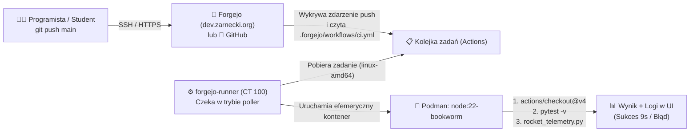

# Demo CI/CD: GitHub Actions (nr 1 dla studentów), Forgejo Actions i Cloudflare Workers

**Koło Naukowe DevOps & Virtualization Lab (WSKZ)**  
Praktyczne repozytorium referencyjne do **Projektu 3 (Automatyzacja CI/CD)**.  
- **Dla studentów (ścieżka główna):** zaczynacie od **GitHub Actions** ([`.github/workflows/ci.yml`](./.github/workflows/ci.yml)) i instrukcji krok po kroku w [`SCENARIUSZE_DLA_STUDENTOW.md`](./SCENARIUSZE_DLA_STUDENTOW.md).
- **Własny serwer koła (Forgejo):** opis przypadku i konfiguracja self-hosted runnera ([`.forgejo/workflows/ci.yml`](./.forgejo/workflows/ci.yml)).
- **Dodatek chmurowy (opcjonalny):** automatyczne wdrażanie na **Cloudflare Workers** ([`CLOUDFLARE_WORKERS_PORADNIK.md`](./CLOUDFLARE_WORKERS_PORADNIK.md)).

---

## 1. Opis stworzonego przypadku (Case Study)

W ramach prac wdrożeniowych uruchomiliśmy kompletne, samowystarczalne środowisko CI/CD w naszej infrastrukturze laboratoryjnej:

1. **Serwer Git (Forgejo):** instancja pod adresem `https://dev.zarnecki.org` (wewnętrznie `http://192.168.162.190:3000`), organizacja `uczelnie`, repozytorium testowe `forgejo-ci-demo`.
2. **Wykonawca zadań (`forgejo-runner`):** kontener LXC `CT 100` uruchomiony na Proxmox VE z usługą `forgejo-runner` (`v13.2.2`), etykietą `linux-amd64` oraz silnikiem kontenerowym **Podman** i wstępnie pobranym obrazem `node:22-bookworm`.
3. **Aplikacja demonstracyjna:** prosty moduł w Pythonie ([`rocket_telemetry.py`](./rocket_telemetry.py)) z testami jednostkowymi ([`test_rocket.py`](./test_rocket.py)) w `pytest`. Sama aplikacja jest celowo lekka — cały nacisk położony jest na **mechanikę Actions**.

### Lekcja z wdrożenia (rzeczywisty przypadek diagnostyki)
Po pierwszym uruchomieniu kontenera `CT 100` runner był widoczny w panelu Forgejo jako **offline**. Analiza logów usługi `forgejo-runner.service` wykazała pętlę restartów spowodowaną brakiem protokołu w pliku `/etc/forgejo-runner/config.yaml`:
```text
invalid `server` settings: connection "forgejo" is invalid: malformed `url` "192.168.162.190:3000": parse "192.168.162.190:3000": invalid URI for request
```
Po dopisaniu schematu `http://192.168.162.190:3000` i restarcie usługi runner zarejestrował się poprawnie (`[poller] launched`), a pierwszy push uruchomił pełny pipeline, który wykonał się w **9 sekund**.

---

## 2. Jak to działa pod maską? (Architektura)



**Kluczowa zasada:** Serwer Git (Forgejo / GitHub) **nie wykonuje** kodu u siebie! On tylko przechowuje kod, wykrywa zdarzenie (`push`, `pull_request`) i wystawia zadanie. Zadanie podejmuje **Runner** (u nas: własny kontener `CT 100` na Proxmoxie; na GitHubie: maszyna wirtualna z puli Microsoft/GitHub), który stawia czyste, izolowane środowisko, wykonuje kroki z pliku YAML i odsyła logi oraz status (zielony ✅ / czerwony ❌).

---

## 3. Jak stosować to u siebie (Forgejo) vs na GitHubie

W tym repozytorium oba światy są rozdzielone na dwa katalogi z pełnymi komentarzami linijka po linijce:

| Cecha | Własny serwer (Forgejo) | Chmura (GitHub) |
|---|---|---|
| **Katalog z workflow** | [`.forgejo/workflows/ci.yml`](./.forgejo/workflows/ci.yml) | [`.github/workflows/ci.yml`](./.github/workflows/ci.yml) |
| **Runner (`runs-on`)** | `linux-amd64` (nasz `CT 100` w Proxmox) | `ubuntu-latest` (chmura GitHuba) |
| **Środowisko startowe** | Kontener Podman `node:22-bookworm` | Pełna VM Ubuntu z preinstalowanym Pythonem |
| **Instalacja Pythona** | `apt-get install python3 python3-pytest` | `uses: actions/setup-python@v5` |
| **Gdzie są Sekrety** | `Ustawienia repo → Actions → Sekrety` | `Settings → Secrets and variables → Actions` |
| **Koszt / Limity** | Brak limitów minut, pełna prywatność | Darmowy limit minut dla kont prywatnych, nielimitowane dla publicznych |

> **Wskazówka:** Jeśli chcesz mieć **jeden** plik zamiast dwóch, Forgejo potrafi czytać także katalog `.github/workflows/`. Rozdzielenie na `.forgejo/` i `.github/` stosujemy wtedy, gdy nazwy runnerów (`linux-amd64` vs `ubuntu-latest`) lub dostępne narzędzia różnią się między naszym serwerem a chmurą.

---

## 4. Automatyczne wdrażanie na Cloudflare Workers

Repozytorium zawiera również gotowy przykład i workflow dla **Cloudflare Workers** (serverless Edge API):
- Kod Workera: [`cloudflare-worker-demo/`](./cloudflare-worker-demo/)
- Workflow Forgejo: [`.forgejo/workflows/deploy-cloudflare-worker.yml`](./.forgejo/workflows/deploy-cloudflare-worker.yml)
- Workflow GitHub: [`.github/workflows/deploy-cloudflare-worker.yml`](./.github/workflows/deploy-cloudflare-worker.yml)
- **Pełny poradnik krok po kroku:** [`CLOUDFLARE_WORKERS_PORADNIK.md`](./CLOUDFLARE_WORKERS_PORADNIK.md)

---

## 5. Materiały na zajęcia ze studentami

Zobacz plik [`SCENARIUSZE_DLA_STUDENTOW.md`](./SCENARIUSZE_DLA_STUDENTOW.md) — zawiera gotowe scenariusze pokazowe na żywo (zielony build, celowe zepsucie testu i blokada merge'a, Pull Request Gate, `workflow_dispatch`, macierze, sekrety i artefakty).
